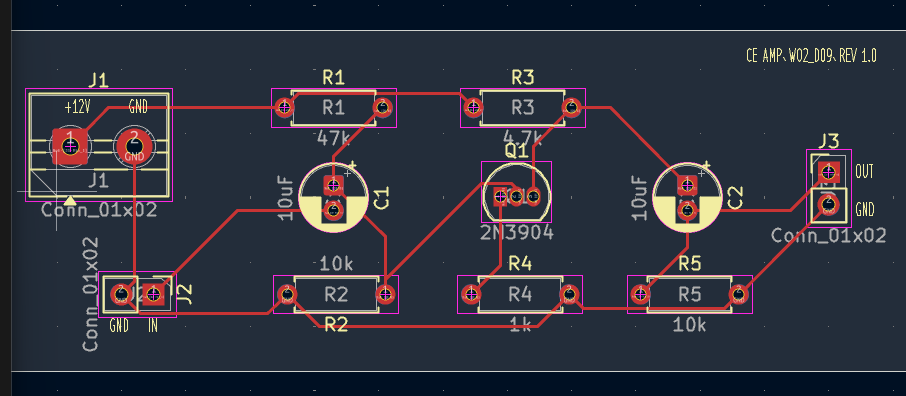
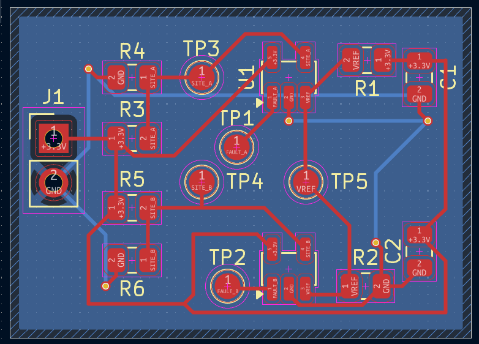

# KiCad PCB Design Practice

Hands-on KiCad exercises covering schematic capture, component footprints, PCB layout, design-rule checks, 3D inspection, and manufacturing-file review.

> **Scope:** This repository documents learning exercises. The boards shown here have **not** been fabricated, assembled, or physically tested.

## Projects

| Project | What I practiced | Status | Details |
| --- | --- | --- | --- |
| **01 · Zener Voltage Regulator** | 12 V input / nominal 5.1 V Zener regulator; schematic, PCB routing, 3D review, DRC, Gerber/Drill inspection | PCB design exercise completed; physical verification pending | [Open project](Zener_Regulator/README.md) |
| **02 · Common-Emitter Amplifier** | 2N3904 共射極放大器、DC 偏壓、電壓增益、PCB Layout、ERC／DRC 與 Gerber 檢視 | PCB 設計完成，待實體驗證 | [Open project](CommonEmitter_Amplifier/README.md) |
| **03 · Dual-Site Power Monitoring & Fault Detection Board** | 雙通道電源監控、LTspice、TLV7031、雙層 PCB、GND Plane | [Open project](mini-loadboard-power-monitor/README.md) |

## Project 01 · Zener Voltage Regulator

[View the full Zener Regulator design notes →](Zener_Regulator/README.md)

## Project 02 · Common-Emitter Amplifier

[View the full CommonEmitter Amplifier design notes →](CommonEmitter_Amplifier/README.md)

## Project 02 · 雙測試位置電源監控與故障偵測板

模擬兩個測試位置的供電路徑電阻差異，使用 LTspice 分析節點壓降與理想故障判斷邏輯，並在 KiCad 建立 TLV7031 比較器原理圖、雙層 PCB、測試點及背面接地銅箔平面。

模擬條件： 3.3V 供電，理想故障判斷門檻為 3.25V。

模擬結果： SITE_A 約 3.290V、SITE_B 約 3.203V，理想故障觸發臨界路徑電阻約 5.077Ω。

工程交付： LTspice 模擬、KiCad 原理圖與 PCB、ERC／DRC、BOM、Gerber 及 Drill 資料。

驗證限制： 尚未使用實際 TLV7031 SPICE 模型或實體量測驗證比較器切換門檻。

[View the full CommonEmitter Amplifier design notes →](mini-loadboard-power-monitor/README.md)

---

*Each exercise has its own README with the circuit, design images, checks, and limitations. New projects will be added to the table above.*
