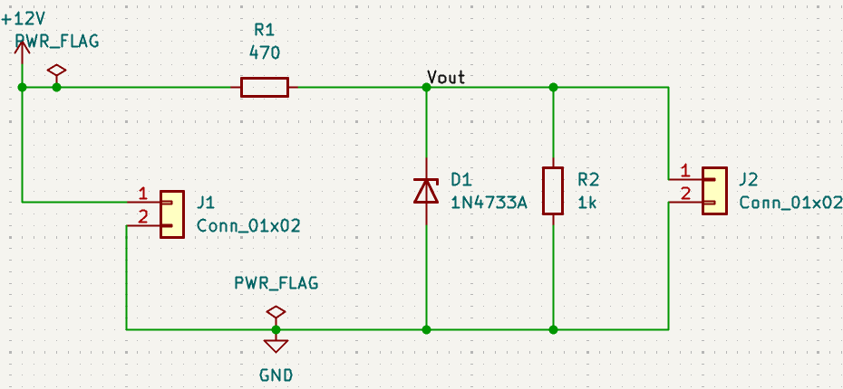

[← Back to project index](../README.md)

# Project 01 — Zener Diode Voltage Regulator

**Objective:** Design a simple Zener shunt-regulator PCB with a 12 V DC input and a nominal 5.1 V output. The project covers schematic capture, footprint assignment, PCB layout, electrical/design rule checks, 3D inspection, and fabrication-file export.

### Design overview

| Item | Configuration |
| --- | --- |
| EDA tool | KiCad 10.0.7 |
| Input | 12 V DC (J1, 2-pin terminal block) |
| Output | Nominal 5.1 V (J2, 2-pin terminal block) |
| R1 | 470 Ω, series current-limiting resistor |
| R2 | 1 kΩ, demonstration load |
| D1 | 1N4733A, 5.1 V nominal Zener diode |
| J1 / J2 | 2-position, 5.08 mm pitch terminal-block footprints |
| PCB | Routed PCB design with front copper and Gerber/Excellon exports |

**Circuit principle:** R1 limits current from the 12 V input; D1 is connected in reverse bias across the output and R2 represents a load. Regulation depends on the supply voltage, load current and the actual Zener characteristics; 5.1 V is a nominal target, **not a guaranteed measured output**.

### 1. Schematic


### 2. PCB Layout


### 3. PCB 3D


### 4. DRC Result


### 5. Gerber Viewer


The captured KiCad check showed:

| Check | Result |
| --- | --- |
| DRC violations | 0 |
| Unconnected items | 0 |
| Schematic / PCB parity violations | 0 |
| Documented exclusions | 2 (J1/J2 footprint-filter mismatches) |
| Ignored test categories | 3 (see check settings) |

**Interpretation:** No violations were reported by the enabled checks at the time of the screenshot. This does not certify physical dimensions, electrical safety, or manufacturability. Two footprint-filter exceptions were documented; the exact ordered parts must still be checked against their datasheets.

### 5. Gerber and drill-file review


Gerber (`.gbr`) and Excellon drill (`.drl`) files were generated and reviewed locally using KiCad GerbView. **Fabrication files are not included in this repository.** They are practice outputs, not released manufacturing files.

### Files

```text
Zener_Regulator/
├── README.md
├── W02_K01_Zener_Regulator.kicad_pro
├── W02_K01_Zener_Regulator.kicad_sch
├── W02_K01_Zener_Regulator.kicad_pcb
├── images/
│   ├── 01_Schematic.png
│   ├── 02_PCB_Layout.png
│   ├── 03_PCB_3D.png
│   ├── 04_DRC_Result.png
│   └── 05_Gerber_Viewer.png
```

Open `W02_K01_Zener_Regulator.kicad_pro` with KiCad Project Manager to inspect the source design.

### Known limitations / next verification steps

- **No PCB has been fabricated, assembled or measured.** All results above are KiCad design outputs and screenshots.
- Verify exact manufacturer part numbers, terminal-block dimensions, pad/hole sizes and diode polarity against datasheets.
- Verify worst-case Zener and resistor power dissipation, resistor power ratings, thermal margin and input-voltage range.
- Review copper width/clearance, board-edge clearance, solder-mask and silkscreen capabilities against the chosen PCB manufacturer's constraints.
- Revisit the three ignored DRC test categories and the two documented connector footprint-filter exclusions before any fabrication release.

## Learning scope

This repository is for practicing **schematic design → ERC → footprint selection → PCB layout → DRC → 3D review → Gerber/Drill generation**. It is an educational exercise rather than a tested or mass-production-ready product.
