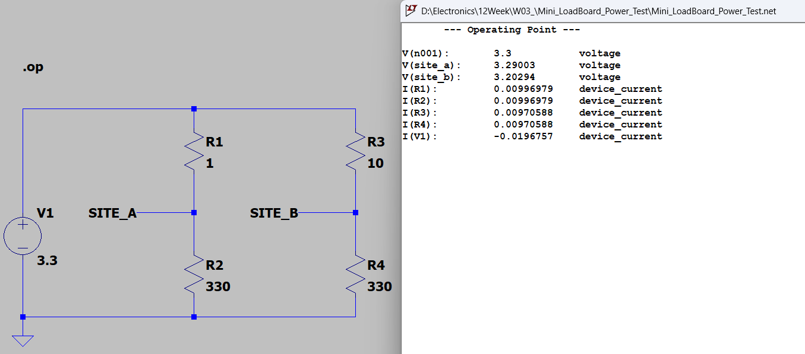
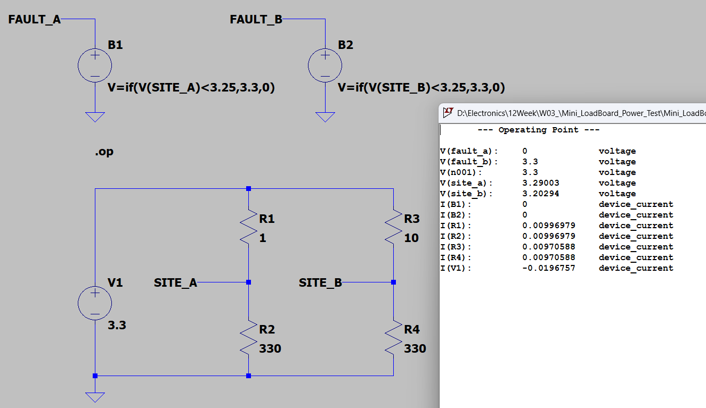
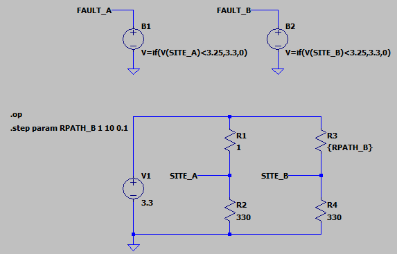
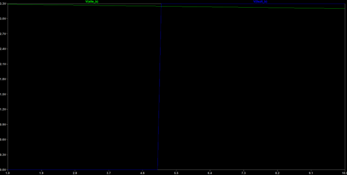
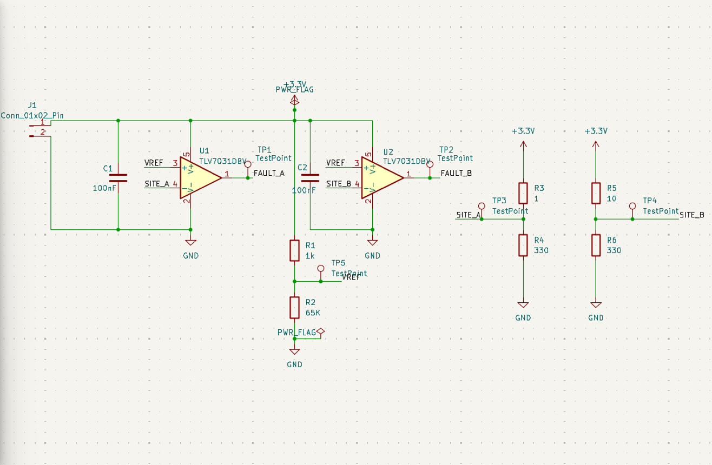
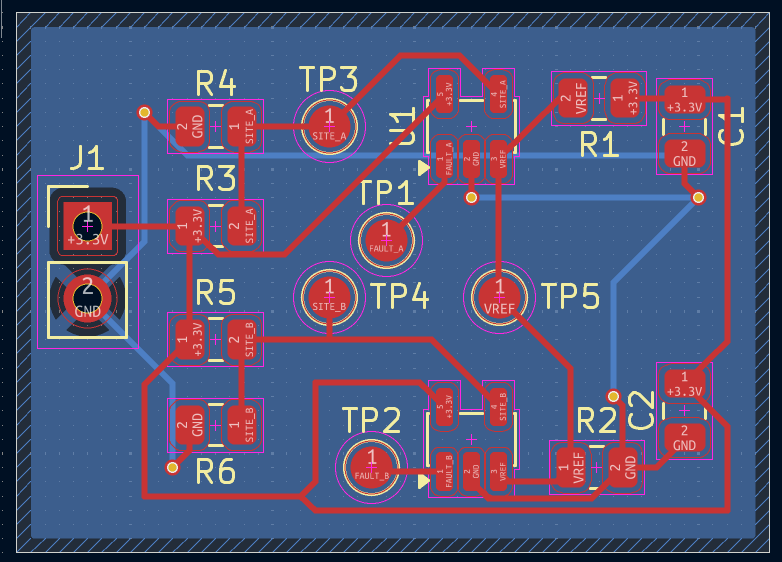
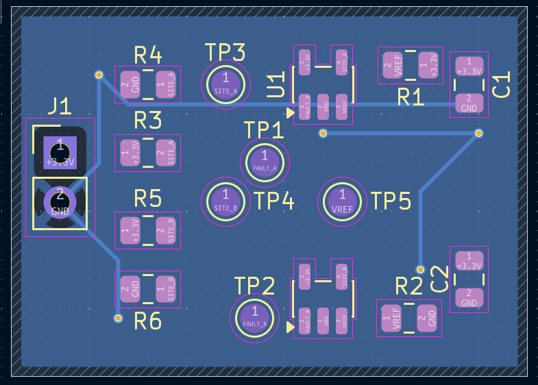
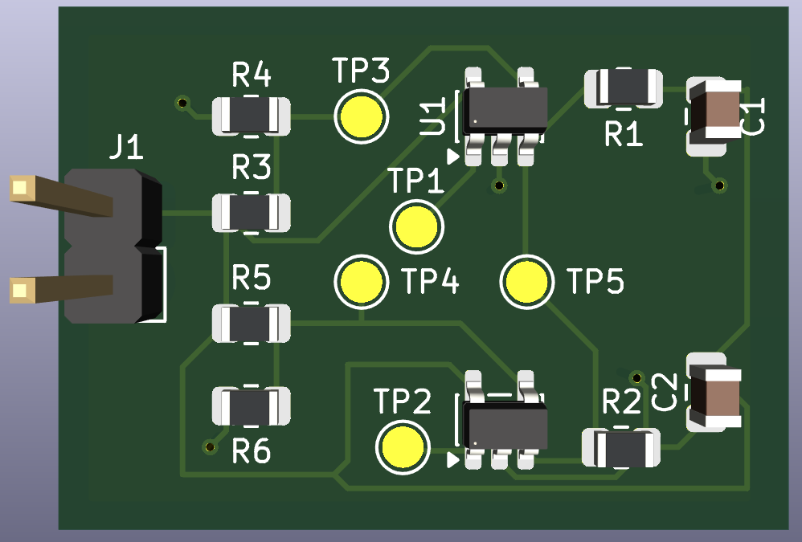
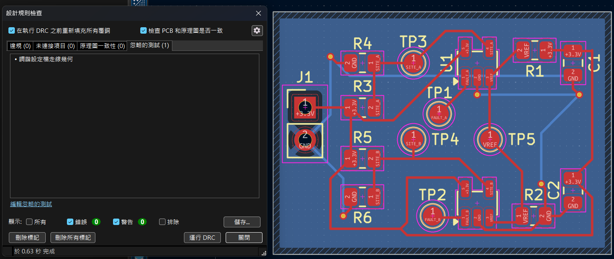

# 雙測試位置電源監控與故障偵測板

**Dual-Site Power Monitoring & Fault Detection Board**

> 專案狀態：已完成 LTspice 理想模型驗證、KiCad 原理圖、PCB 佈線及製造資料輸出；**尚未進行實體打樣、比較器實際模型驗證或電氣量測**。

## 1. 專案目的

以簡化的雙測試位置（Site A／Site B）電源路徑作為練習案例，觀察不同路徑電阻造成的電壓降，並建立低電壓故障判斷邏輯。進一步使用 KiCad 將理想判斷概念轉換為含比較器、參考電壓、測試點與雙層 PCB 的設計初版，練習從模擬、原理圖、封裝配置、PCB 佈線到製造資料整理的工程流程。

本專案是**教學與作品集用途的簡化測試電路**，不是可直接使用的商用半導體 Load Board／BIB。

## 2. 開發工具與設計內容

| 類別 | 工具／內容 |
|---|---|
| 直流及參數掃描 | LTspice（`.op`、`.step`、Behavioral Voltage Source） |
| 原理圖與 PCB | KiCad 10.0 |
| 設計架構 | 3.3 V 供電、雙 Site 負載、兩顆 TLV7031DBV 比較器 |
| PCB | 雙層板，F.Cu 走線、B.Cu GND 銅箔區、接地 Via |
| 輸出資料 | ERC／DRC、Gerber、Excellon Drill、BOM CSV、3D 檢視 |

## 3. LTspice：雙通道直流分析



理想電源為 3.3 V；兩個 Site 均使用 330 Ω 負載，路徑電阻則分別設為 1 Ω 與 10 Ω，用於展示供電路徑阻抗不同時的壓降差異。

| 指標 | Site A | Site B |
|---|---:|---:|
| 路徑電阻 | 1 Ω | 10 Ω |
| 負載電阻 | 330 Ω | 330 Ω |
| DC 工作點電壓 | 3.29003 V | 3.20294 V |
| 支路電流 | 9.96979 mA | 9.70588 mA |
| 3.3 V 與 Site 電壓差 | 約 9.97 mV | 約 97.06 mV |

> 證據：LTspice `.op` 模擬畫面。以上數據屬理想電路模型，並非實體量測。

## 4. LTspice：理想故障判斷與門檻掃描

使用行為電壓源（Behavioral Voltage Source）描述理想低電壓故障判斷：

```text
V=if(V(SITE_A)<3.25,3.3,0)
V=if(V(SITE_B)<3.25,3.3,0)
```

當監控電壓低於 3.25 V 時，理想模型輸出 3.3 V（故障）；否則輸出 0 V（正常）。



| 監控位置 | DC 電壓 | 理想 Fault 輸出 | 判定 |
|---|---:|---:|---|
| SITE_A | 3.29003 V | 0 V | 正常 |
| SITE_B | 3.20294 V | 3.3 V | 故障 |

為了找出故障觸發條件，將 Site B 的路徑電阻設定為參數 `RPATH_B`，以 0.1 Ω 間隔從 1 Ω 掃描至 10 Ω。





理想分壓模型：

$$
V_{SITE\_B}=3.3\times\frac{330}{RPATH_B+330}
$$

當 `V(SITE_B) = 3.25 V` 時，理論臨界路徑電阻約為 **5.077 Ω**。以 0.1 Ω 掃描時，首次觀察到理想故障輸出跳升的掃描點約為 **5.1 Ω**。曲線的橫軸是電阻參數，**不是時間**。

> 重要限制：上述 `if()` 僅用來確認理想判斷邏輯；沒有模擬 TLV7031 的實際偏移電壓、內建遲滯、輸入範圍、輸出負載或動態切換特性。

## 5. KiCad：實際元件原理圖



在 KiCad 原理圖中使用兩顆 TLV7031DBV 作為電壓比較器，並以 R1 = 1 kΩ、R2 = 65 kΩ 建立共用參考電壓。在理想 3.3 V 供電及標稱電阻值下：

$$
V_{REF}=3.3\times\frac{65k}{1k+65k}=3.25\,V
$$

比較器以 `VREF` 接正相輸入、各 Site 接反相輸入，預期在 Site 電壓低於參考門檻時使 `FAULT` 輸出轉為高電位。另配置 100 nF 去耦電容、J1 供電接頭及 TP1～TP5 測試焊墊。

| 測試點 | 網路 | 功能 |
|---|---|---|
| TP1 | FAULT_A | Site A 故障輸出 |
| TP2 | FAULT_B | Site B 故障輸出 |
| TP3 | SITE_A | Site A 監控電壓 |
| TP4 | SITE_B | Site B 監控電壓 |
| TP5 | VREF | 參考電壓 |

**注意**：LTspice 與 KiCad 的電阻參考編號各自獨立，請以相對應原理圖與 BOM 為準；不得直接以編號相同視為同一顆實體電阻。KiCad 的參考電壓是取自同一組 3.3 V 電源的分壓器，無法提供獨立於供電變化的精密欠壓基準。

## 6. PCB Layout、接地設計與 3D



PCB 採雙層設計：正面 F.Cu 配置電源與訊號走線；背面 B.Cu 設置 GND 銅箔區，並透過接地 Via 連接正面 SMD 的 GND 焊墊。設計時優先考慮比較器附近的去耦、測試點可接近性與雙 Site 分區。





以上為 PCB 編輯器與 3D 模型呈現的**預期組裝外觀**，並非已製作完成的實體電路板。

## 7. 設計規則檢查與製造資料



最終截圖顯示：**0 個 DRC 違規、0 個未連接項目、0 個原理圖一致性問題**。畫面仍顯示有一類未啟用的檢查（調諧設定槽走線），因此應表述為「已啟用規則檢查通過」，而非所有可能的檢驗均已完成。

專案檔案：

- [LTspice 原始檔](LTspice/Mini_LoadBoard_Power_Test.asc)
- [KiCad 專案](KiCad/Mini_LoadBoard_Power_Test.kicad_pro)
- [KiCad 原理圖](KiCad/Mini_LoadBoard_Power_Test.kicad_sch)
- [KiCad PCB](KiCad/Mini_LoadBoard_Power_Test.kicad_pcb)
- [BOM 物料清單（CSV）](docs/Mini_LoadBoard_Power_Test.csv)
- [Gerber 製造圖形檔](fab/gerber/)
- [PTH 鑽孔檔（Excellon）](fab/Mini_LoadBoard_Power_Test-PTH.drl)
- [PTH 鑽孔圖（PDF）](fab/Mini_LoadBoard_Power_Test-PTH-drl_map.pdf)

BOM 為設計元件表，包含 Reference、Value、Footprint 及 Qty；尚未全面確認製造商料號及採購替代料。Gerber／Drill 的輸出不代表已送板生產。

## 8. 已完成與待驗證項目

| 項目 | 狀態 |
|---|---|
| LTspice 理想 DC 模型與壓降分析 | 已完成 |
| LTspice 理想故障邏輯與參數掃描 | 已完成 |
| KiCad 原理圖與初版 PCB Layout | 已完成 |
| 已啟用 ERC／DRC 規則檢查 | 已通過 |
| Gerber、Drill、BOM 輸出 | 已完成整理 |
| TLV7031 實際 SPICE 模型與門檻容差 | **尚未驗證** |
| 電源變動、電阻公差、雜訊與遲滯 | **尚未驗證** |
| 完整料號、PCB 製造條件與組裝相容性 | **送板前待確認** |
| 實體 PCB 打樣與量測 | **尚未執行** |

## 9. 專案收穫

本專案練習將**問題定義 → 理想模型 → 參數掃描 → 元件原理圖 → PCB 走線與接地 → 設計規則檢查 → 製造資料輸出**串連成可追溯的工程過程。後續若製作實體電路板，將以測試點電壓、故障切換門檻、電源誤差及比較器輸出為量測重點，並將實測結果與理想模型進行比較。
